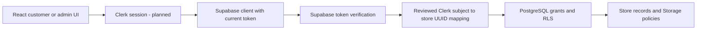

# Riris Emporium architecture

Step 1 baseline · 6 November 2026 · development only

The owner has deferred customer launch until the website is complete. This document records the agreed architecture and separates it from the current implementation. Historical Task 2–5 reports and `BETA-READINESS.md` remain unchanged; their dated status and server URLs are historical evidence, not current release approval.

## Decisions and responsibilities

| Area | Agreed design | Current implementation |
| --- | --- | --- |
| Frontend | React 19, TypeScript, Vite, Tailwind CSS | React SPA in `app/`; React Router, shared UI components, npm lockfile |
| Authentication | Clerk using existing `@clerk/react` | Adapters compile and have synthetic tests; inactive. Supabase Auth remains active until approved migration passes replacement tests. |
| Database | Supabase PostgreSQL | Browser services use Supabase Data API. Actual schema/RLS not exported or verified. |
| Storage | Supabase Storage for approved store assets | `imageService.ts` uploads to `product-images`; permissions and bucket settings unverified. |
| State | Zustand with verified account-scoped state | Auth/cart/UI stores plus shared verified identity; old request results cannot restore another account's cart. |
| Checkout | WhatsApp only | Draft handoff to **2348072105878**. Owner sends bank details and manually verifies payment. No gateway or automatic confirmed-order creation. |
| Hosting | Vercel, project root `app` | Local config prepared; remote root/branch/environment settings unverified. |
| Version control | GitHub, reviewed checkpoints | `store-improvements` for development; `main` reserved for production-ready releases. |

`server/` contains only a legacy `.env.example`. There is no runnable Express API, payment server or authoritative database migration directory. Do not infer backend functionality from that template or the older root README. No new framework, repository reorganization or backend was introduced in Step 1.

## Frontend boundaries

| Path under `app/` | Responsibility |
| --- | --- |
| `src/main.tsx` | Validate public configuration before dynamically importing the application; render setup/unavailable errors without printing values. |
| `src/App.tsx` | Lazy route composition, existing layouts and authenticated/admin UI route guards. |
| `src/pages/`, `src/pages/admin/` | Storefront, product, account, cart, WhatsApp checkout, support and admin screens. Some admin/history pages still query Supabase directly. |
| `src/components/layout/`, `product/`, `cart/`, `ui/` | Shared navigation/layout, product/wishlist actions, cart drawer and primitive controls. |
| `src/services/` | Product, cart, order, profile/Auth, Storage and legacy payment request boundaries; defensive payload mapping and error propagation. |
| `src/hooks/` | React subscription/hydration and account-scoped actions (`useAuth`, `useCart`, `useVerifiedUser`, `useWishlist`). |
| `src/store/` | Auth UI, cart request lifecycle and UI state. Persisted UI identity is not authorization. |
| `src/auth/clerk/` | Inactive provider/access gates, session controller, native-token Supabase client factory, activation checklist and UUID mapping boundary. |
| `src/lib/` | Pure calculation/validation/mapping helpers; active Supabase client and verified-session coordination. `src/utils/supabase.ts` is a legacy wrapper to review during cutover. |
| `src/types/` | Frontend contracts; these are not proof of database types or permissions. |
| `tests/` | Unit/service-boundary tests, six intercepted browser suites, synthetic fixtures and reproduction README. |
| Configuration | `package-lock.json`, TypeScript/Vite/Tailwind/ESLint files, `vercel.json`, placeholder environment templates. |
| `../docs/` | Historical reports, migration design, unexecuted SQL proposals, architecture/workflow and current step report. |

Keep this organization. When changing a feature, move its direct database query into its existing service only where that improves ownership/error testing. Retain pure helpers for calculations and explicit payload whitelists. Consolidate duplicated Auth utilities during the reviewed cutover, not through a wholesale rewrite. Keep test-only entries outside the production build and put approved executable migrations in a clearly separate versioned location later; current SQL remains review material.

## Authentication and identity

The target flow is:

Today, the active app uses `lib/supabase.ts`, `lib/verifiedSession.ts` and Supabase Auth. `main.tsx` and `App.tsx` do not mount Clerk. A public Clerk key is not an activation switch. The staged root requires a reviewed development target, UUID mapping, server authorization and replacement-flow tests; production builds, including ordinary Vercel preview builds, remain denied by that gate.

The native Supabase third-party integration is the chosen token path: configure the approved issuer and supply the current Clerk session token through the Supabase `accessToken` callback. The JWT's authenticated database role is not store-admin authority. No deprecated JWT-template integration or browser service-role client is planned. [Supabase Clerk integration](https://supabase.com/docs/guides/auth/third-party/clerk).

Clerk subjects are text, typically `user_…`, and must not replace UUID values in existing relationships. The proposed additive design preserves legacy users/UUIDs/FKs, introduces a stable store-profile UUID with a unique Clerk subject and optional approved legacy link, and adds reviewed resource ownership links. Exact tables, types, constraints and compatibility with existing `user_id NOT NULL`/Auth FKs require inspection first. Do not cast subjects to UUID, create fake Supabase accounts, or link accounts solely by matching email.

`resolveStoreIdentity` rejects absent/foreign/malformed mappings and delayed results after a session change. Its loader is injected; no invented provisioning RPC is called. A future trusted, idempotent provisioning/linking command must derive identity from a verified token and disallow requested owner/role changes. The complete dependency inventory and proposal are in [CLERK-SUPABASE-MIGRATION.md](CLERK-SUPABASE-MIGRATION.md).

At cutover, replace login/signup/recovery/profile/session flows together, preserve safe local return destinations, connect every data service/store to the same mapped identity, and retire legacy subscriptions/token keys only after tests pass. Hosted Clerk flows, provisioning, multi-tab behavior and live authorization remain unverified.

## Data flow and authorization

Pages call hooks/stores and services; services validate writable fields, send the public project key and current access token, and map responses into UI types. Supabase must validate token issuer/signature and enforce PostgreSQL/Storage authorization on each request. A browser owner filter, hidden admin link or decoded token is insufficient.

The target administrator authority is a private, owner-managed membership or equivalently reviewed immutable claim. Only current-account/current-session role results may inform UI gates. Customers must not edit roles, identity links, verified claims, other owners' data, catalog records, fulfillment/payment state or authoritative amounts. The old development `DEV_FORCE_ADMIN` toggle is a UI bypass only and must not be used as evidence of authorization; retire it during the Clerk replacement.

Review both `USING` and `WITH CHECK`, column/table grants, existing permissive policies, private helper privileges/search paths, exposed views/RPCs and Storage. Synthetic guest/A/B/admin direct API tests must prove denial even when the UI is bypassed. The RLS proposal is entirely commented; the read-only metadata script has not been run.

## Data assumptions and persistence

| Resource | Observed code contract / limitation |
| --- | --- |
| Products | Flat `price`, `image`, `stock`, `featured`, category and timestamp fields; create/edit use the same whitelist. SKU/compare-price support needs schema confirmation. Only the first image is persisted; configurable gallery/low-stock thresholds are not implemented. Publication is not verified; mapper assumes active. |
| Profiles | Legacy `users` with UUID-like owner ID and name/phone/role fields. Writable profile fields exclude identity and role. Clerk provisioning/linking is pending. Saved-address UI is disabled. |
| Cart | `carts` owner, JSON `items`, total/discount/coupon and revision timestamp. Reads do not create rows. Mutations normalize current catalog prices, merge duplicate product/variant identities, recompute estimates and use owner/revision predicates. Unique owner and revision triggers need verification. |
| Wishlist | Product IDs in `localStorage` under `riris:wishlist:v1:<verified-id>`. Browser/device/origin-local, not encrypted or synchronized. Current UUID namespace cannot be migrated to a Clerk subject without trusted ownership proof. |
| Orders | Existing order records contain owner, JSON items, totals, addresses, status/timestamps and optional references/tracking. Detail reads check ownership; historical list/mutation gaps remain. No automatic WhatsApp order persistence. |
| Payments/reviews/coupons | Legacy assumed contracts; payment mutation APIs disabled, broad historical reads/author and coupon rules require review. No browser-calculated price is payment authority. |
| Storage | Public product-image URLs, generated object names. Admin writes, MIME/size limits and abandoned-image cleanup need verification. No customer documents belong in a public bucket. |

Cart state distinguishes loading/ready/guest/error. Account changes clear visible data synchronously; captured generations reject stale reads, mutation results and queued actions. Returning users reload their saved cart. An already submitted write cannot be recalled, and cross-tab/database concurrency still requires development verification.

The shared cart utility computes display estimates in minor currency units. Current Cart/Drawer estimates retain 7.5% tax, ₦2,500 delivery and free delivery strictly above ₦10,000; they are not verified policy. WhatsApp quotes merchandise subtotal only and explicitly leaves delivery/tax/discounts for owner confirmation. Inventory is refreshed, not reserved; unknown variant pricing is blocked rather than guessed.

## WhatsApp order lifecycle

1. Customer signs in, selects products and enters contact/delivery details.
2. Checkout validates the current account/cart and builds an encoded draft for **2348072105878**, including names, quantities, unit/line prices and merchandise estimate.
3. Customer opens WhatsApp, reviews and sends the message themselves. Popup/link fallback and “Nothing has been sent” wording remain honest. The cart is preserved; form/draft stay in current-page memory and can be lost on reload. Account/cart changes invalidate an old draft in the app.
4. Owner confirms stock, delivery and final charges, manually sends bank details and independently checks received funds. A draft, customer-edited message or transfer screenshot is not automatic payment proof.
5. Owner arranges fulfillment. A future reviewed manual-order feature may record item/customer snapshots, separate payment/delivery statuses and audit events; it is not implemented here.

Opening WhatsApp creates no database order, payment, email or invoice and does not clear the cart. Disabled payment initialization/verification/refund and browser order-creation methods must remain blocked. The unused Flutterwave package remains in the lockfile for now; this is not permission to re-enable it. Test actual app handoff/message delivery only in a separately approved manual test.

## Environments, errors and limits

Use separate approved Clerk/Supabase development and production settings. Required public frontend names are `VITE_SUPABASE_URL`, `VITE_SUPABASE_PUBLISHABLE_DEFAULT_KEY` (or `VITE_SUPABASE_ANON_KEY`) and, for the prepared replacement, `VITE_CLERK_PUBLISHABLE_KEY`. WhatsApp needs no payment key. `.env.local` and environment variants are private; committed examples contain placeholders. No private key/password/service role belongs in `VITE_`. See [DEVELOPMENT-WORKFLOW.md](DEVELOPMENT-WORKFLOW.md).

Missing configuration must stop initialization, show useful variable names in development and generic unavailability in production, without printing values. Service errors must propagate; failed reads must not become invented empty data, and failed mutations must not display success. Account changes must invalidate pending private-data results. Existing weaker profile/history/sign-out paths are Step 2 follow-ups, not verified security guarantees.

There is no authorized schema export, applied RLS migration, trusted provisioning backend, live Clerk replacement test or release-ready policy inventory. Known placeholder/disabled controls, lint findings, shipping/legal copy and manual order management remain documented in Task 5 and beta reports. Those limitations are acceptable for a local development checkpoint, not customer launch.
